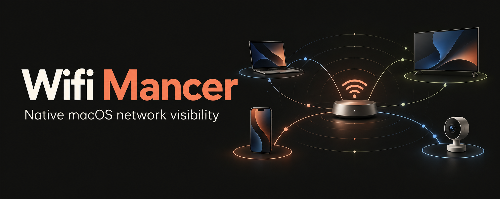

# Wifi Mancer

A native macOS app for discovering devices, inspecting network identity and managing an allowlist on networks you own or administer. Built with SwiftUI and a privileged Swift/C helper connected over authenticated XPC.

**Experimental community project.** Discovery is incomplete on some networks. The active targeting engine covers IPv4 on compatible local networks; it cannot guarantee Internet blocking for every device or router. IPv6, isolation and visibility limitations remain. A targeted device is not proof of a blocked Internet connection.

[Community launch](docs/COMMUNITY_STATUS.md) · [Roadmap](ROADMAP.md) · [Command status](docs/COMMAND_STATUS.md) · [Contributing](CONTRIBUTING.md) · [Discussions](https://github.com/smailkorchi/wifimancer/discussions) · [Security](SECURITY.md)

## What is here

- **Recon and Devices:** observed IP/MAC bindings, vendor lookup, Bonjour/UPnP/reverse-name evidence and device classification. Unknown devices stay unknown rather than becoming phones by default.
- **Lobby:** device graph, allowlist controls and session status.
- **Networks and Profiles:** CoreWLAN network selection and per-network preferences.
- **Throughput:** capture-based counters and a speed-test interface. Current per-device counters are not verified WAN upload/download measurements.
- **Arsenal:** 99 command recipes for local or optional remote execution. Many need dependencies, implementation fixes or compatibility evidence. Read the complete [command inventory](docs/COMMAND_STATUS.md) before treating a recipe as supported.

The [roadmap](ROADMAP.md) prioritizes cleanup correctness, fresh device observations, reliable events and honest status reporting. Feature presence in the UI does not establish completion.

## Build from source

The project declares macOS 14+ and currently builds for **Apple Silicon / arm64**. That is a build target, not a tested matrix of macOS versions. Use Xcode with its command-line tools selected, Homebrew and XcodeGen.

```bash
git clone https://github.com/smailkorchi/wifimancer.git
cd wifimancer
./Scripts/bootstrap.sh
./Scripts/build.sh
```

The result is `build/Build/Products/Release/Wifi Mancer.app`. Bootstrap installs XcodeGen and libpcap for development; the helper links the macOS SDK's system libpcap. Core discovery does not invoke nmap or Bettercap. Optional Arsenal recipes have their own dependencies.

Build and inspect the app as your normal user. **Do not run the build as root.** The older Python `WifiMancer` script is a retained legacy implementation, separate from the native app.

### Helper and permissions

Install your reviewed app at `/Applications/Wifi Mancer.app`. macOS may request Local Network permission, Location permission for Wi-Fi names, and approval of the helper in Login Items.

For personal ad hoc builds, the manual helper installer is:

```bash
sudo /bin/bash ./Scripts/install-helper.sh
```

This privileged step installs the helper, launch entry and an exact client-signature pin. Review the script first. Rerun it after replacing the app or helper: changed signatures are rejected until the pin is refreshed. The GUI runs as your user; the helper has root privileges. Opening or reconnecting the GUI ends an existing helper targeting session.

Personal builds are ad hoc signed and are not notarized releases. Gatekeeper handling varies by macOS version and local policy. Do not disable system security to make a build run. Installer scripts `pkg.sh` and `dmg.sh` remain experimental; they are not a verified replacement for the signature-pin installation step. No binary release is certified by this README.

### Offline checks

Run only the tests relevant to your change. These examples exercise fixtures rather than live devices:

```bash
bash Tests/Identification/run.sh
bash Tests/IdentityCache/run.sh
bash Tests/Session/run.sh
bash Tests/Authentication/run.sh
bash Tests/Media/run.sh
```

See [CONTRIBUTING.md](CONTRIBUTING.md) for test selection and reporting. Do not use an Arsenal recipe as a test runner. Live playback, radio changes and network disruption require separate explicit authorization for the test scope.

## Contribute

Start with a reproducible issue, a redacted device-identification fixture or an offline regression for a [roadmap](ROADMAP.md) item. Keep fixes small and distinguish source inspection, fixture passes and live acceptance in your PR. Device names, addresses, screenshots, packet captures and credentials can identify a household; sanitize them before posting.

Use [Discussions](https://github.com/smailkorchi/wifimancer/discussions) for questions and design proposals, and [Issues](https://github.com/smailkorchi/wifimancer/issues) for actionable defects. Vulnerabilities follow [SECURITY.md](SECURITY.md).

## Layout

| Path | Purpose |
| --- | --- |
| `App/` | SwiftUI screens, state and optional command runners |
| `Helper/` | Privileged XPC service, scanning and packet engines |
| `Shared/` | Models, identification, vendor lookup and XPC protocol |
| `Resources/` | App artwork, model/vendor data and media runner |
| `Tests/` | Offline Swift/C/Python fixtures and focused runners |
| `Scripts/` | Build, packaging and reviewed helper installation |
| `docs/` | Architecture plan, command inventory and release notes |

## License

Original project code is available under the [MIT License](LICENSE), copyright © 2026 El Qorchi Ismail. Third-party components and data retain their own terms; see [THIRD_PARTY_NOTICES.md](THIRD_PARTY_NOTICES.md). The project is independent and is not affiliated with Apple or device manufacturers.
